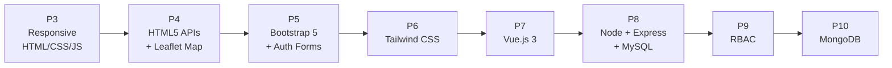
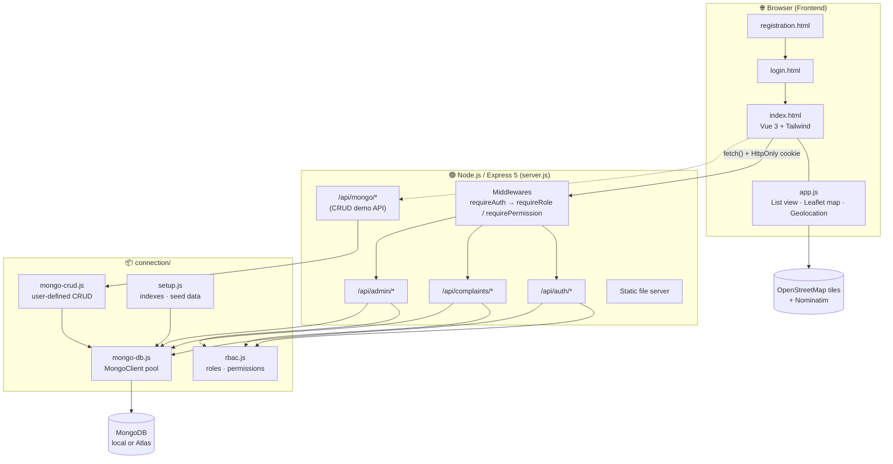
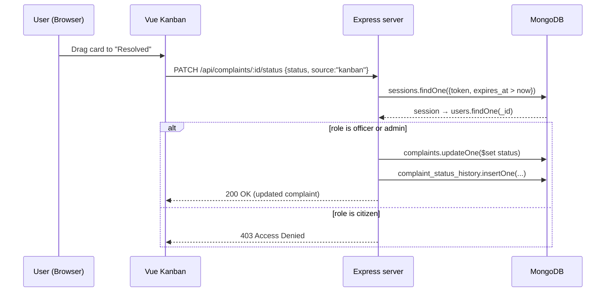
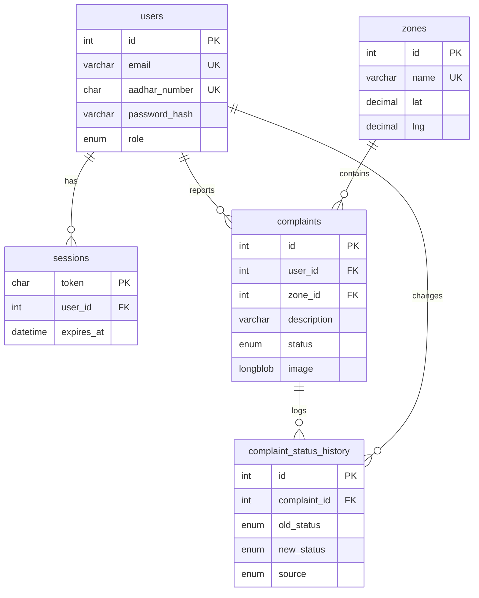

<div align="center">

# 🏙️ CivicGrid

**An area-wise civic complaint manager, built up one practical at a time from a responsive static page to a full-stack Node.js + MongoDB app with role-based access control.**


*B.Tech Semester 5 · Full Stack Development (FSD) Lab*

</div>

---

## 📑 Table of Contents

- [About the Project](#about)
- [Features at a Glance](#features)
- [Tech Stack](#tech-stack)
- [System Architecture](#architecture)
- [Project Structure](#project-structure)
- [Getting Started](#getting-started)
- [Demo Accounts](#demo-accounts)
- [Available npm Scripts](#npm-scripts)
- [**Practical-wise Documentation**](#practicals)
  - [Practical 3: Responsive Web Design](#practical-3)
  - [Practical 4: HTML5 APIs (Geolocation, Local Storage, Drag & Drop)](#practical-4)
  - [Practical 5: Bootstrap 5 (Online & Offline) + Registration/Login](#practical-5)
  - [Practical 6: Tailwind CSS](#practical-6)
  - [Practical 7: Vue.js 3 (Reactive Kanban & Custom Directives)](#practical-7)
  - [Practical 8: Node.js + Express + MySQL Backend](#practical-8)
  - [Practical 9: Role-Based Authentication & Access Control (RBAC)](#practical-9)
  - [Practical 10: Node.js with MongoDB (CRUD + Full Migration)](#practical-10)
- [REST API Reference](#api-reference)
- [Database Design (MongoDB)](#database-design)
- [Troubleshooting](#troubleshooting)
- [Security Notes & Known Limitations](#security-notes)
- [Further Documentation](#further-docs)
- [Author & License](#author)

---

<a id="about"></a>
## 📌 About the Project

**CivicGrid** lets citizens report civic problems such as potholes, broken streetlights, water leaks and garbage dumps, grouped by city **zone/area**. Municipal officers track each complaint through a **Reported → In Progress → Resolved** lifecycle.

The project is cumulative. Each lab practical adds a new web technology to the same application instead of starting from scratch:



The `main` branch holds the **latest state (Practical 10)**. Each earlier practical is kept on its own branch or commit; links are in the [practical-wise section](#practicals).

---

<a id="features"></a>
## ✨ Features at a Glance

| Area | Features |
|---|---|
| **Complaint management** | Report issues with a description, zone, reporter details (name, Aadhar, age, gender, residence) and an optional photo (≤ 5 MB) |
| **Two views** | **List view** grouped by area, plus a **Kanban board** with drag-and-drop status changes |
| **Maps & location** | Leaflet + OpenStreetMap map with status-coloured markers, click-to-pin, browser **Geolocation**, and reverse geocoding through Nominatim |
| **Authentication** | Registration and login with **scrypt**-hashed passwords and **HttpOnly** session cookies (7-day expiry, MongoDB TTL index) |
| **RBAC** | Three roles (**Citizen**, **Officer**, **Admin**), 10 fine-grained permissions, and Express middlewares `requireAuth`, `requireRole` and `requirePermission` |
| **Admin panel** | List all users with complaint counts, change roles, and view the system-wide status-change audit log |
| **Audit trail** | Every status change (create / list / kanban / seed) is recorded with who made it and when |
| **Viva helpers** | One-click demo login, a live role switcher, an on-screen permission matrix, and CLI demo scripts |
| **MongoDB CRUD API** | A standalone `/api/mongo/*` REST API with filters and aggregation statistics |

---

<a id="tech-stack"></a>
## 🧰 Tech Stack

| Layer | Technology |
|---|---|
| **Markup / Styling** | HTML5, CSS3 (Flexbox, media queries, `vw` units), Bootstrap 5.3, Tailwind CSS (Play CDN), Google Fonts *Inter* |
| **Client-side JS** | Vanilla ES2020+, Vue 3 (global build via CDN), Leaflet 1.9.4, Fetch API |
| **Browser APIs** | Geolocation, Local Storage (P4–P7), HTML5 Drag & Drop, FileReader |
| **Server** | Node.js (≥ 20.19), Express 5, Multer (in-memory uploads), Node `crypto` (scrypt, random tokens) |
| **Databases** | MySQL via `mysql2` (Practicals 8–9) → **MongoDB** via the official `mongodb` driver v7 (Practical 10, current) |
| **Tooling** | npm, Git (one branch per practical), MongoDB Compass / Atlas, XAMPP (for MySQL practicals) |

---

<a id="architecture"></a>
## 🏗️ System Architecture



**Request lifecycle for a protected action, e.g. dragging a Kanban card:**



---

<a id="project-structure"></a>
## 📂 Project Structure

```
CivicGrid/
├── connection/                     # Backend modules
│   ├── mongo-config.js             # P10  MongoDB URI / DB name from .env + friendly error messages
│   ├── mongo-db.js                 # P10  MongoClient connection manager (connect, ping, getDb, close)
│   ├── mongo-crud.js               # P10  User-defined CRUD functions (create/read/update/delete/aggregate)
│   ├── mongo-crud-demo.js          # P10  CLI walkthrough of every CRUD operation
│   ├── setup.js                    # P10  Collections, unique + TTL indexes, seed users/zones/complaints
│   ├── rbac.js                     # P9   Roles, permissions, role→permission matrix, demo users
│   ├── rbac-demo.js                # P9/10 CLI RBAC policy evaluation demo (on MongoDB)
│   ├── config.js                   # P8   MySQL connection settings (legacy)
│   ├── db.js                       # P8   MySQL connection pool + promise helpers (legacy)
│   ├── schema.js                   # P8   MySQL CREATE TABLE definitions (legacy)
│   ├── crud.js                     # P8   User-defined MySQL functions: selectAll/Record/Unique, deleteRecord
│   └── crud-demo.js                # P8   CLI demo of the MySQL functions (legacy)
├── bootstrap/                      # P5   Offline Bootstrap 5 CSS & JS bundle
│   ├── css/bootstrap.min.css
│   └── js/bootstrap.bundle.min.js
├── index.html                      # Main dashboard: Vue Kanban, list view, map, RBAC panel, admin panel
├── app.js                          # Frontend logic: API calls, Leaflet map, geolocation, list view
├── login.html                      # Login with one-click demo-role buttons
├── registration.html               # Citizen/officer/admin registration form
├── tailwind_demo.html              # P6   Tailwind CSS concept showcase page
├── bootstrap_online.html           # P5   Bootstrap via CDN demo
├── bootstrap_offline.html          # P5   Bootstrap via local files demo
├── server.js                       # Express 5 app: auth, RBAC middleware, complaint/admin/mongo routes
├── RBAC_FLOW_AND_ACCESS_CONTROL.md # P9   In-depth RBAC flows & code walkthrough
├── PRACTICAL_10_MONGODB_CRUD.md    # P10  In-depth MongoDB CRUD docs + viva questions
├── .env.example                    # Environment variable template
└── package.json                    # Dependencies & npm scripts
```

---

<a id="getting-started"></a>
## 🚀 Getting Started

### 1. Prerequisites

| Requirement | Version / Notes |
|---|---|
| **Node.js** | **20.19 or newer** (required by `mongodb` driver v7; `process.loadEnvFile` is also used) |
| **npm** | Comes with Node.js |
| **MongoDB** | Either a local server (Community Edition, Docker, …) on `27017`, **or** a free **MongoDB Atlas** cluster |
| **Git** | To switch between practical branches |
| *MySQL (optional)* | Only to run Practicals 8–9 from their branches (XAMPP works) |

### 2. Clone & install

```bash
git clone https://github.com/Priyansh9506/CivicGrid.git
cd CivicGrid
npm install
```

### 3. Configure environment

```bash
cp .env.example .env        # Windows PowerShell: Copy-Item .env.example .env
```

Edit `.env`:

```ini
# Port the CivicGrid server listens on
PORT=3000

# ── MongoDB (current backend) ──
# Local server:
MONGO_URI=mongodb://127.0.0.1:27017
# …or MongoDB Atlas:
# MONGO_URI=mongodb+srv://<user>:<password>@<cluster>.mongodb.net/?retryWrites=true&w=majority
MONGO_DB_NAME=civicgrid_mongo

# ── MySQL (only used by the legacy Practical 8 scripts) ──
DB_HOST=localhost
DB_PORT=3306
DB_USER=root
DB_PASSWORD=
DB_NAME=civicgrid
```

> 💡 **Atlas tip:** `connection/mongo-db.js` sets Node's DNS resolver to Google Public DNS (`8.8.8.8`, `8.8.4.4`) so `mongodb+srv://` SRV lookups work on networks whose DNS blocks them (some college/ISP networks). Also add your IP under **Atlas → Network Access**.

### 4. Initialise the database

```bash
npm run setup
```

This creates the collections and indexes, seeds the 3 demo users, 5 zones and 4 sample complaints, then runs a quick insert-and-update check.

### 5. Run the app

```bash
npm start
```

Open **http://localhost:3000**. It redirects to `login.html`.

> ⚠️ **Don't open the HTML files directly with `file://`.** The pages call the REST API using a same-origin session cookie, so they have to be served by `npm start`.

---

<a id="demo-accounts"></a>
## 🔑 Demo Accounts

These are seeded automatically by `npm run setup` and on every server start. `login.html` has one-click buttons for each.

| Role | Name | Email | Password | Can… |
|---|---|---|---|---|
| 👤 **Citizen** | Aarav Mehta | `citizen@civicgrid.org` | `Citizen@123` | Report & view complaints, delete **own** complaints |
| 🛡️ **Officer** | Inspector Patel | `officer@civicgrid.org` | `Officer@123` | Everything a citizen can view/create + **change status** (Kanban / list) + inspect |
| 👑 **Admin** | Commissioner Sharma | `admin@civicgrid.org` | `Admin@123` | Everything + delete **any** complaint, manage user roles, view audit log |

---

<a id="npm-scripts"></a>
## 📜 Available npm Scripts

| Command | File | Practical | What it does |
|---|---|:---:|---|
| `npm start` | `server.js` | 10 | Initialises MongoDB and starts the web server on `PORT` (default 3000) |
| `npm run setup` | `connection/setup.js` | 10 | Creates collections & indexes, seeds data, demonstrates insert + update |
| `npm run mongo-demo` | `connection/mongo-crud-demo.js` | 10 | Full CLI walkthrough of MongoDB CRUD + aggregation |
| `npm run rbac-demo` | `connection/rbac-demo.js` | 9 / 10 | Prints the role hierarchy & permission matrix, evaluates allow/deny scenarios, simulates role changes |
| `npm run crud-demo` | `connection/crud-demo.js` | 8 | MySQL user-defined functions demo. *Legacy: run it from the `practical-8` branch (see [Practical 8](#practical-8))* |

---

<a id="practicals"></a>
## 🧪 Practical-wise Documentation

Quick navigation:

| # | Topic | Branch / Commit | Key Files |
|:---:|---|---|---|
| [3](#practical-3) | Responsive web design | commit [`f066b93`](https://github.com/Priyansh9506/CivicGrid/commit/f066b93) | `index.html`, `app.js` |
| [4](#practical-4) | HTML5 APIs + Leaflet map | [`practical-4`](https://github.com/Priyansh9506/CivicGrid/tree/practical-4) · commit [`eacab52`](https://github.com/Priyansh9506/CivicGrid/commit/eacab52) | `index.html`, `app.js` |
| [5](#practical-5) | Bootstrap 5 + forms | [`practical-5`](https://github.com/Priyansh9506/CivicGrid/tree/practical-5) | `bootstrap_*.html`, `registration.html`, `login.html` |
| [6](#practical-6) | Tailwind CSS | [`practical-6`](https://github.com/Priyansh9506/CivicGrid/tree/practical-6) | `tailwind_demo.html` + all pages |
| [7](#practical-7) | Vue.js 3 | shipped in commit [`138619c`](https://github.com/Priyansh9506/CivicGrid/commit/138619c) | `index.html` (Vue app) |
| [8](#practical-8) | Node.js + Express + MySQL | [`practical-8`](https://github.com/Priyansh9506/CivicGrid/tree/practical-8) | `server.js`, `connection/*` |
| [9](#practical-9) | RBAC | [`practical-9`](https://github.com/Priyansh9506/CivicGrid/tree/practical-9) | `connection/rbac.js`, `server.js` |
| [10](#practical-10) | MongoDB CRUD + migration | [`practical-10`](https://github.com/Priyansh9506/CivicGrid/tree/practical-10) / `main` | `connection/mongo-*.js`, `setup.js` |

To look at any practical locally:

```bash
git checkout practical-6      # or practical-4, practical-5, practical-8, ...
git checkout main             # back to the latest version
```

---

<a id="practical-3"></a>
### 🔹 Practical 3: Responsive Web Design

> **Aim:** Build a responsive civic task-management UI using the viewport meta tag, responsive images, `vw`-based typography, `max-width`, Flexbox and media-query breakpoints.

**What was built:** the first version of CivicGrid, an **Area-Wise Task Manager**. Users add civic tasks, choose an area, optionally attach a photo, mark tasks complete and delete them. Tasks are rendered grouped by area.

**Concepts demonstrated**

| Concept | Implementation |
|---|---|
| Viewport meta tag | `<meta name="viewport" content="width=device-width, initial-scale=1.0">` |
| Responsive images | `<picture>` with different sources per browser width, plus `max-width: 100%` |
| Fluid typography | Heading sized with `font-size: 5vw`, adjusted to `6vw` at the tablet breakpoint |
| Width constraints | Main container `max-width: 900px`, images `max-width: 800px` |
| Flexbox layout | Header, task rows and controls laid out with `display: flex` |
| Media queries | Breakpoints at `768px` (tablet) and `480px` (mobile) |
| JavaScript | JSON task array, DOM manipulation, `map` / `filter` / `reduce`, **FileReader API** for image previews |

**Files:** `index.html`, `app.js` · **Run:** open `index.html` from commit `f066b93` in a browser.

---

<a id="practical-4"></a>
### 🔹 Practical 4: HTML5 APIs (Geolocation, Local Storage, Drag & Drop)

> **Aim:** Extend Practical 3 with three HTML5 APIs: **Geolocation**, **Local Storage** and **Drag and Drop**.

**What was built**

1. **Geolocation API:** a "📍 Detect location" button calls `navigator.geolocation.getCurrentPosition()` and attaches the user's coordinates to a complaint.
2. **Local Storage API:** tasks are saved under the `civicgrid_tasks` key, so they survive a page reload.
3. **Drag and Drop API:** a new **Kanban board view** with three columns (📋 Reported · 🔧 In Progress · ✅ Resolved). Cards use `draggable="true"`, `dragstart`, `dragover` and `drop`, and dropping a card changes its status.
4. **List ↔ Kanban toggle:** the original Practical 3 list view still works alongside the board.
5. **Interactive Leaflet map** (second commit `eacab52`): an OpenStreetMap map with status-coloured markers. You can click the map to drop a pin, and coordinates are converted to an address with **Nominatim reverse geocoding**.

```js
// Geolocation → reverse geocode → fill the location field
navigator.geolocation.getCurrentPosition(async ({ coords }) => {
    const res = await fetch(`https://nominatim.openstreetmap.org/reverse?lat=${coords.latitude}&lon=${coords.longitude}&format=json`);
    // ...
});
```

**Files:** `index.html`, `app.js` · **Branch:** [`practical-4`](https://github.com/Priyansh9506/CivicGrid/tree/practical-4). The canonical Practical 4 snapshot is commit [`eacab52`](https://github.com/Priyansh9506/CivicGrid/commit/eacab52); the branch tip also contains the first Practical 5 commit.

---

<a id="practical-5"></a>
### 🔹 Practical 5: Bootstrap 5 (Online & Offline) + Registration / Login

> **Aim:** Use Bootstrap 5 both **online (CDN)** and **offline (local files)**, and build a responsive registration and login flow with it.

**What was built**

| File | Purpose |
|---|---|
| `bootstrap_online.html` | Loads Bootstrap 5.3 CSS/JS from the jsDelivr **CDN** |
| `bootstrap_offline.html` | Loads the same framework from **local files** in `bootstrap/css` and `bootstrap/js`, so it works without internet |
| `registration.html` | Bootstrap card form: first/last name, mobile (`pattern="[0-9]{10}"`), 12-digit Aadhar (`pattern="[0-9]{12}"`), email, password and address, with HTML5 validation |
| `login.html` | Email + password sign-in against users saved in Local Storage |
| `index.html` | **Auth guard:** redirects to `login.html` when no `civicgrid_currentUser` is stored, shows a welcome message, pre-fills reporter name and Aadhar, and adds a Sign Out button |

**Bootstrap concepts used:** the grid (`container`, `row`, `col-md-8 col-lg-6`), cards, form controls, buttons, alerts and spacing utilities.

**Data flow (client-only at this stage):** `registration` → `localStorage['civicgrid_users']` → `login` → `localStorage['civicgrid_currentUser']` → dashboard.

**Branch:** [`practical-5`](https://github.com/Priyansh9506/CivicGrid/tree/practical-5)

---

<a id="practical-6"></a>
### 🔹 Practical 6: Tailwind CSS

> **Aim:** Demonstrate and apply the **utility-first** Tailwind CSS framework.

**What was built**

- **All pages restyled with Tailwind:** `index.html`, `login.html` and `registration.html` moved from hand-written CSS and Bootstrap to Tailwind utility classes. The hand-written CSS in `index.html` dropped by roughly 900 lines.
- **Custom theme** through the Tailwind Play CDN config:
  ```js
  tailwind.config = {
      theme: { extend: { colors: { brand: { 50: '#fff7ed', 500: '#f97316', 600: '#ea580c', 700: '#c2410c' } } } }
  }
  ```
- **`tailwind_demo.html`:** a standalone showcase page with a hero section, stat cards and a component gallery, explaining the key concepts:

| Concept | Example classes |
|---|---|
| Utility-first styling | `flex`, `p-4`, `rounded-xl`, `shadow-sm` |
| Hover / focus state modifiers | `hover:bg-brand-600`, `focus:ring-2` |
| Responsive breakpoints | `sm:`, `md:`, `lg:` (e.g. `grid-cols-1 sm:grid-cols-2 lg:grid-cols-4`) |
| Custom design tokens | `bg-brand-500`, `text-brand-700` |

**Branch:** [`practical-6`](https://github.com/Priyansh9506/CivicGrid/tree/practical-6) · **View:** open `tailwind_demo.html` (or `http://localhost:3000/tailwind_demo.html` while the server runs).

---

<a id="practical-7"></a>
### 🔹 Practical 7: Vue.js 3 (Reactive Kanban & Custom Directives)

> **Aim:** Use the **Vue.js** framework for reactive rendering, event handling and custom directives.

**What was built**

- **Vue 3 app** (global build from CDN) mounted on `#app` in `index.html`.
- **Kanban board moved to Vue:** columns and cards render reactively with `v-for` / `v-if`. Drag and drop is handled through `@dragstart`, `@dragend`, `@dragover` and `@drop` in Vue `methods`.
- **Shared state bridge:** `app.js` pushes the task list into `window.vueComponent.state`, so the vanilla-JS list view and the Vue Kanban always show the same data.
- **Three custom directives:**

| Directive | Behaviour |
|---|---|
| `v-uppercase-click` | Turns an element's text uppercase when clicked |
| `v-dynamic-list` | Fills a `<select>` with `<option>`s from a bound array (used for the zone list) |
| `v-format-date` | Formats a timestamp as e.g. `Oct 18, 02:30 PM` (re-runs on `updated`) |

```js
vueApp.directive('format-date', {
    mounted(el, binding) {
        el.innerText = new Date(binding.value).toLocaleDateString('en-US',
            { month: 'short', day: 'numeric', hour: '2-digit', minute: '2-digit' });
    }
});
```

> 📝 The Vue.js work was committed together with the Practical 8 backend in commit [`138619c`](https://github.com/Priyansh9506/CivicGrid/commit/138619c). The `practical-7` branch currently points to the same commit as `practical-6`.

---

<a id="practical-8"></a>
### 🔹 Practical 8: Node.js + Express + MySQL Backend

> **Aim:** (I) Build a backend for CivicGrid with **Node.js** and **MySQL**. (II) Demonstrate Node.js with MySQL performing **delete record, select record, select unique and select all** through user-defined functions.

**What was built: (I) full-stack backend**

- **Express server (`server.js`)** serving the frontend and a JSON REST API. Local Storage was replaced with real server-side persistence.
- **Authentication:** passwords hashed with `crypto.scryptSync` and a random 16-byte salt, compared with `timingSafeEqual`. Sessions use a random 32-byte token stored in the DB and sent as an **HttpOnly, SameSite=Lax** cookie.
- **Image uploads:** **Multer** with in-memory storage (PNG/JPEG/GIF/WebP, ≤ 5 MB), saved as `LONGBLOB` and served from `/api/complaints/:id/image`.
- **Status audit trail:** each change is written to `complaint_status_history` with its source (`create`, `list`, `kanban` or `seed`).
- **Setup script:** creates the database and tables and seeds zones and sample complaints.

**Relational schema (`connection/schema.js`)**



**(II) User-defined MySQL functions (`connection/crud.js`).** All identifiers are escaped with `mysql.escapeId` and values are bound with `?` placeholders, which prevents SQL injection.

| Function | SQL generated |
|---|---|
| `selectAll(table, { columns, orderBy })` | `SELECT … FROM table ORDER BY …` |
| `selectRecord(table, conditions)` | `SELECT … FROM table WHERE col = ? AND …` |
| `selectUnique(table, column)` | `SELECT DISTINCT column … ORDER BY value` |
| `deleteRecord(table, conditions)` | `DELETE FROM table WHERE …` → returns `affectedRows` |

**Run (from the practical branch, with MySQL running, e.g. via XAMPP):**

```bash
git checkout practical-8
npm install
npm run setup        # create DB + tables + seed
npm run crud-demo    # selectAll / selectRecord / selectUnique / deleteRecord
npm start
```

> On `main`, `setup.js` targets MongoDB, so `npm run crud-demo` only works there if the Practical 8 MySQL database already exists. Use the `practical-8` branch to reproduce this practical exactly.

---

<a id="practical-9"></a>
### 🔹 Practical 9: Role-Based Authentication & Access Control (RBAC)

> **Aim:** Demonstrate a **Role-Based Authentication and Access Control** system using JavaScript.

**Role hierarchy (`connection/rbac.js`)**

| Level | Role | Badge | Who |
|:---:|---|---|---|
| 1 | `citizen` | 👤 Citizen | Public community member |
| 2 | `officer` | 🛡️ Officer | Municipal ward staff / field inspector |
| 3 | `admin` | 👑 Admin | Municipal commissioner / system administrator |

**Permission matrix**

| Permission | Description | 👤 Citizen | 🛡️ Officer | 👑 Admin |
|---|---|:---:|:---:|:---:|
| `profile:read` | View own profile | ✅ | ✅ | ✅ |
| `complaint:read` | View complaints | ✅ | ✅ | ✅ |
| `complaint:create` | Report a complaint | ✅ | ✅ | ✅ |
| `complaint:status:update` | Change status (Kanban / list) | ❌ | ✅ | ✅ |
| `complaint:delete:own` | Delete own complaint | ✅ | ❌ | ✅ |
| `complaint:delete:any` | Delete anyone's complaint | ❌ | ❌ | ✅ |
| `complaint:inspect` | Inspect details & history | ❌ | ✅ | ✅ |
| `user:read` | List all users | ❌ | ❌ | ✅ |
| `user:role:update` | Change a user's role | ❌ | ❌ | ✅ |
| `rbac:audit` | View the system audit log | ❌ | ❌ | ✅ |

**Enforcement on the server (Express middlewares in `server.js`)**

```js
app.post  ('/api/complaints',            requireAuth, requirePermission(PERMISSIONS.COMPLAINT_CREATE), ...);
app.patch ('/api/complaints/:id/status', requireAuth, requireRole(ROLES.OFFICER, ROLES.ADMIN), ...);
app.get   ('/api/admin/users',           requireAuth, requireRole(ROLES.ADMIN), ...);
```

- `requireAuth` validates the session cookie and attaches `req.user`. It returns **401** when the session is missing or invalid.
- `requireRole(...roles)` and `requirePermission(perm)` return **403** with a descriptive JSON error.
- **Ownership check on delete:** admins can delete anything, citizens only their own complaints, and officers are denied.

**Enforcement in the UI.** The UI hides or disables what a role can't do, but the server still checks every request.

- Colour-coded role badge in the header, plus a live **"My Permissions" matrix**
- Kanban drag-and-drop is locked for citizens and shows a read-only notice
- `Complete` / `Undo` buttons are shown only to officers and admins. `Remove` is shown only for the owner or an admin
- **Admin panel:** a user list with complaint counts and inline role dropdowns
- **One-click role switcher** and **quick-login buttons** for live viva demonstrations

**Run:** `npm run rbac-demo` (CLI) or `npm start` and log in with each [demo account](#demo-accounts).

📘 **Deep dive:** [`RBAC_FLOW_AND_ACCESS_CONTROL.md`](RBAC_FLOW_AND_ACCESS_CONTROL.md) covers authentication, authorization, deletion and role-elevation flows, persona walkthroughs and code explanations.

**Branch:** [`practical-9`](https://github.com/Priyansh9506/CivicGrid/tree/practical-9) (runs on MySQL)

---

<a id="practical-10"></a>
### 🔹 Practical 10: Node.js with MongoDB (CRUD + Full Migration)

> **Aim:** Demonstrate Node.js using **MongoDB** to perform **Create, Read, Update and Delete** operations.

This practical was delivered in three steps:

| Step | Commit | Change |
|---|---|---|
| 1 | [`eae5168`](https://github.com/Priyansh9506/CivicGrid/commit/eae5168) | User-defined MongoDB CRUD module, CLI demo and `/api/mongo/*` REST API |
| 2 | [`77705d8`](https://github.com/Priyansh9506/CivicGrid/commit/77705d8) | **Entire app backend migrated from MySQL to MongoDB** (auth, sessions, complaints, RBAC, admin) |
| 3 | [`9b25710`](https://github.com/Priyansh9506/CivicGrid/commit/9b25710) | **MongoDB Atlas** support (`mongodb+srv://`) with a DNS-resolver fix and `.env` configuration |

**User-defined CRUD functions (`connection/mongo-crud.js`)**

| Operation | Function | MongoDB driver call |
|---|---|---|
| **Create** | `createOne(col, doc)` | `insertOne` (adds `createdAt`) |
| | `createMany(col, docs)` | `insertMany` |
| **Read** | `readAll(col, { filter, projection, sort, limit, skip })` | `find().toArray()` |
| | `readOne(col, filter)` / `readById(col, id)` | `findOne` (string → `ObjectId`) |
| | `readDistinct(col, field)` | `distinct` |
| **Update** | `updateOneRecord` / `updateById` / `updateManyRecords` | `updateOne` / `updateMany` with `$set` + `updatedAt` |
| **Delete** | `deleteOneRecord` / `deleteById` / `deleteManyRecords` | `deleteOne` / `deleteMany` |
| **Aggregate** | `aggregateRecords(col, pipeline)` | `aggregate([...])`, e.g. `$group` + `$sum` + `$sort` |

**CLI walkthrough: `npm run mongo-demo`** (uses the `civic_complaints` collection and resets it first)

1. Connect & `ping` the server
2. **Create:** `createOne` + `createMany` (batch across zones)
3. **Read:** all, `findOne({ area })`, compound filter (`status` + `priority`), projection, `distinct`
4. **Update:** `updateOne` with `$set`, `updateMany` (bulk priority upgrade)
5. **Aggregate:** complaints grouped & counted by area
6. **Delete:** `deleteOne` by `_id`, `deleteMany` by status
7. Print the remaining documents and close the connection

**MySQL → MongoDB mapping applied during the migration**

| MySQL (P8–P9) | MongoDB (P10) |
|---|---|
| Database → Table → Row | Database → Collection → Document (BSON) |
| `INT AUTO_INCREMENT` PK | `ObjectId` `_id` |
| `UNIQUE` constraint | `createIndex({ email: 1 }, { unique: true })` |
| `JOIN` | `$lookup` + `$unwind` aggregation stages |
| Cron/manual cleanup of expired sessions | **TTL index** `{ expires_at: 1 }, { expireAfterSeconds: 0 }` |
| `LONGBLOB` image column | BSON `Binary` field on the complaint document |
| `ON DELETE CASCADE` | Explicit `deleteMany` on `complaint_status_history` |

📘 **Deep dive:** [`PRACTICAL_10_MONGODB_CRUD.md`](PRACTICAL_10_MONGODB_CRUD.md) has the full CLI output, REST examples and viva Q&A.

**Branch:** [`practical-10`](https://github.com/Priyansh9506/CivicGrid/tree/practical-10) (same as `main`)

---

<a id="api-reference"></a>
## 🌐 REST API Reference

All endpoints return JSON. Errors have the shape `{ "error": "message" }`. Authenticated routes need the `civicgrid_session` cookie, which `POST /api/auth/login` sets.

### Authentication

| Method | Endpoint | Access | Description |
|---|---|---|---|
| `POST` | `/api/auth/register` | Public | Register `{ firstName, lastName, mobileNumber, aadharNumber, emailId, password, address, role }` |
| `POST` | `/api/auth/login` | Public | `{ emailId, password }` → sets session cookie, returns `user` |
| `GET` | `/api/auth/me` | Authenticated | Current user with `role`, `roleMeta` and `permissions` |
| `POST` | `/api/auth/logout` | Authenticated | Deletes the session and clears the cookie |
| `GET` | `/api/auth/roles` | Public | Roles, metadata and the full permission matrix |
| `POST` | `/api/auth/switch-demo-role` | Public *(demo)* | `{ role }` → signs in as the first user with that role |

### Complaints

| Method | Endpoint | Access | Description |
|---|---|---|---|
| `GET` | `/api/zones` | Authenticated | List zones with coordinates |
| `GET` | `/api/complaints` | Authenticated | All complaints, newest first, with creator name & role |
| `POST` | `/api/complaints` | `complaint:create` | `multipart/form-data`: `text`, `area`, `reporterName`, `reporterAadhar`, `reporterAge`, `reporterGender`, `reporterResidence`, `location`, `lat`, `lng`, `image` |
| `GET` | `/api/complaints/:id/image` | Authenticated | Complaint photo (binary) |
| `PATCH` | `/api/complaints/:id/status` | Officer, Admin | `{ status: "reported" \| "inprogress" \| "resolved", source: "list" \| "kanban" }` |
| `GET` | `/api/complaints/:id/history` | Authenticated | Status-change history for one complaint |
| `DELETE` | `/api/complaints/:id` | Admin (any) / Citizen (own) | Delete a complaint and its history |

### Administration

| Method | Endpoint | Access | Description |
|---|---|---|---|
| `GET` | `/api/admin/users` | Admin | All users with `complaintsCount` |
| `PATCH` | `/api/admin/users/:id/role` | Admin | `{ role }` → change a user's role |
| `GET` | `/api/admin/audit` | Admin | Latest 50 status changes system-wide, with actor details |

### MongoDB CRUD demo API (Practical 10)

| Method | Endpoint | Description |
|---|---|---|
| `GET` | `/api/mongo/complaints?area=&status=&priority=` | Read all (optional filters) |
| `GET` | `/api/mongo/complaints/:id` | Read one by `ObjectId` |
| `POST` | `/api/mongo/complaints` | Create one: `{ description, area, priority?, status?, reporter?, location?, tags? }` |
| `POST` | `/api/mongo/complaints/batch` | Create many: `{ complaints: [ ... ] }` |
| `PATCH` | `/api/mongo/complaints/:id` | Update fields by id |
| `DELETE` | `/api/mongo/complaints/:id` | Delete by id |
| `GET` | `/api/mongo/stats` | Aggregation: counts by area and by status |

**Example:**

```bash
curl -X POST http://localhost:3000/api/mongo/complaints \
     -H "Content-Type: application/json" \
     -d '{"description":"Overflowing drain","area":"Paldi","priority":"High"}'

curl http://localhost:3000/api/mongo/stats
```

---

<a id="database-design"></a>
## 🗄️ Database Design (MongoDB)

Database: `MONGO_DB_NAME` (default `civicgrid_mongo`)

| Collection | Purpose | Key fields | Indexes |
|---|---|---|---|
| `users` | Accounts | `first_name`, `last_name`, `email`, `aadhar_number`, `mobile_number`, `password_hash`, `role`, `address` | `email` unique, `aadhar_number` unique (sparse) |
| `sessions` | Login sessions | `token`, `user_id`, `expires_at` | `token` unique, **TTL** on `expires_at` |
| `zones` | City zones | `name`, `lat`, `lng` | `name` unique |
| `complaints` | Civic complaints | `user_id`, `zone_id`, `zone_name`, `description`, `reporter_*`, `status`, `latitude`, `longitude`, `image` (Binary), `image_mime` | `status`, `created_at` (desc) |
| `complaint_status_history` | Audit trail | `complaint_id`, `old_status`, `new_status`, `changed_by`, `source`, `changed_at` | `complaint_id` |
| `civic_complaints` | P10 CRUD demo / `/api/mongo` | `description`, `area`, `priority`, `status`, `reporter`, `tags`, `createdAt` | n/a |

**Seeded zones (Ahmedabad):** North Zone, South Zone, East Zone, West Zone, Downtown.

---

<a id="troubleshooting"></a>
## 🛠️ Troubleshooting

| Symptom | Cause / Fix |
|---|---|
| `❌ Cannot reach MongoDB at mongodb://127.0.0.1:27017` | MongoDB isn't running. Start it: `net start MongoDB` (Windows service), `mongod --dbpath <dir>`, or `docker run -d -p 27017:27017 mongo` |
| `querySrv ENOTFOUND` / timeouts with Atlas | Check `MONGO_URI`, whitelist your IP in **Atlas → Network Access**, and make sure outbound port 27017 isn't blocked on your network |
| `process.loadEnvFile is not a function` / driver install errors | Node.js is too old. Upgrade to **20.19+** |
| Page shows an alert telling you to start the server | You opened the file via `file://`. Run `npm start` and use `http://localhost:3000` |
| Redirected to `login.html` every time | Session missing or expired. Log in again (sessions last 7 days) |
| `403 Access Denied` when dragging cards | Expected for **Citizens**. Switch to the Officer or Admin role |
| `Image must be 5 MB or smaller.` | Upload limit enforced by Multer. Compress the image |
| `EADDRINUSE :3000` | Another process is using the port. Set `PORT=3001` in `.env` |
| Practical 8 `ER_ACCESS_DENIED_ERROR` | Fix `DB_USER` / `DB_PASSWORD` / `DB_PORT` in `.env` (XAMPP: `root`, empty password) |

---

<a id="security-notes"></a>
## 🔒 Security Notes & Known Limitations

This is an academic lab project. Some features exist only to make live demos and vivas easier and **must not be used in production as-is**:

- **`POST /api/auth/switch-demo-role` is unauthenticated.** Anyone can get an admin session. Remove it or put it behind a dev-only flag before deploying.
- **Self-service role selection at registration.** `registration.html` lets new users pick `admin`. In production, every new user should start as `citizen` and only an admin should promote them.
- **`/api/mongo/*` routes have no auth.** They are a standalone CRUD demonstration.
- Demo passwords are published in this README.
- The session cookie has no `Secure` flag. Add it when serving over HTTPS.
- There is no CSRF token and no rate limiting on login.
- `dotenv` is listed as a dependency, but configuration is loaded through Node's built-in `process.loadEnvFile`.

What's already done well: scrypt password hashing with per-user salts, timing-safe comparison, HttpOnly + SameSite cookies, server-side validation of every field, an upload type/size whitelist, parameterised SQL (Practical 8), and blocked static access to `connection/`, `server.js` and `package*.json`.

---

<a id="further-docs"></a>
## 📚 Further Documentation

| Document | Covers |
|---|---|
| [`RBAC_FLOW_AND_ACCESS_CONTROL.md`](RBAC_FLOW_AND_ACCESS_CONTROL.md) | Practical 9: roles, permission matrix, persona walkthroughs, auth/authorization/deletion/role-elevation flows, code walkthrough |
| [`PRACTICAL_10_MONGODB_CRUD.md`](PRACTICAL_10_MONGODB_CRUD.md) | Practical 10: SQL vs NoSQL, CRUD function reference, full CLI output, REST API, viva questions |

---

<a id="author"></a>
## 👤 Author & License

**Priyansh Patel** ([@Priyansh9506](https://github.com/Priyansh9506))
B.Tech, Semester 5 · Full Stack Development Lab

Licensed under the **ISC License** (see `package.json`).

<div align="center">

⭐ *If this repository helped you understand full-stack development step by step, consider starring it!*

</div>
